# Guía para leer el frontend

**Proyecto Data Science — Fundación YPF 2026 · Grupo 10 · Comisión 3**  
Cristian Alejandro Aguilera · Abigail Roxana Vicentelo · Ian Lionel Tapias Díaz

Esta guía explica qué muestra cada parte de la aplicación web y cómo interpretarla. La aplicación se abre en **http://localhost:8080** después de `docker compose up --build -d`.

> **En una frase:** la aplicación estima cuánto petróleo y cuánto gas va a producir un pozo de la Cuenca Neuquina mes a mes, con un rango de incertidumbre, y explica qué datos empujaron esa estimación.

### Novedades de esta versión

| Qué | Dónde se ve |
|---|---|
| Diseño nuevo con superficies translúcidas, fondo de isolíneas y **modo claro / oscuro** | Toda la página (sección 1) |
| Pestaña **"Métricas del modelo"** con 8 gráficos de rendimiento | Sección 7.1 |
| Desplegable **"Cómo leer este gráfico"** en cada gráfico | Secciones 3.4 y 7.1 |
| Botón **Limpiar** junto a Pronosticar | Sección 3.1 |
| Buscador con estado **activo / sin producción** y búsqueda por varias palabras | Sección 3.1 |
| Corrección: los pozos sin producción en su último mes ya no rompen la pantalla; muestran un aviso | Sección 9 |
| Validación de **coordenadas dentro de la Cuenca Neuquina** y aviso si el pozo queda lejos del área elegida | Secciones 4.1 y 9 |
| API más liviana: de 921 MB a 336 MB de RAM, sin cambios para el usuario | README, "Consumo de memoria" |

---

## 1. Las tres pestañas

| Pestaña | Pregunta que responde | Qué necesita | Qué devuelve |
|---|---|---|---|
| **Pozo existente** | "Este pozo ya produce: ¿cuánto va a producir los próximos meses?" | Un pozo del dataset (por sigla o `idpozo`) | Pronóstico de 1 a 12 meses desde su último dato |
| **Pozo nuevo (curva tipo)** | "Si perforo un pozo con estas características, ¿qué producción puedo esperar?" | Formación, zona, tipo de pozo, profundidad, año | Curva de los primeros 24 meses de vida |
| **Métricas del modelo** | "¿Qué tan bien predicen los modelos?" | Nada: se abre directamente | Indicadores y gráficos de test 2024–2025 (sección 7.1) |

**Cuándo usar cada modo:** el modo *existente* es más preciso, porque parte de la historia real del pozo. El modo *nuevo* no tiene historia: es una estimación de referencia ("pozos parecidos a este produjeron así") y su incertidumbre es mayor.

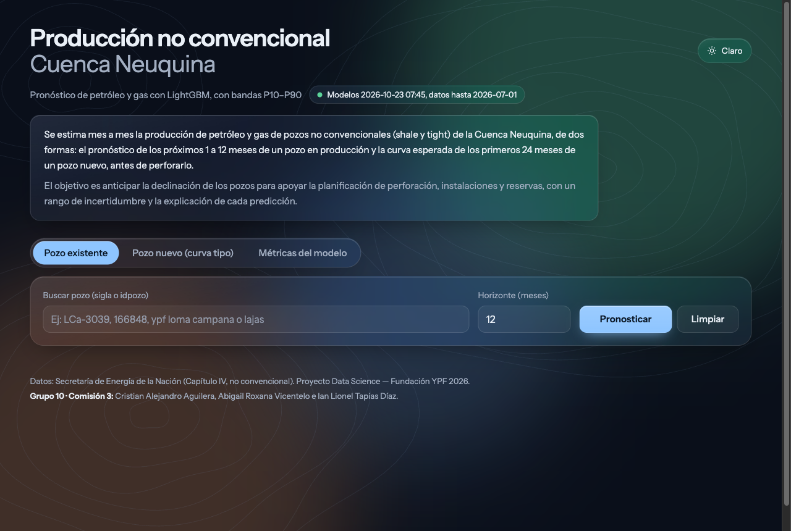

Elementos del encabezado:

- **Estado de la API:** una pastilla con un punto verde muestra la versión de los modelos y hasta qué mes llegan los datos (`datos hasta 2026-07-01`). Si el punto es rojo y dice **"API no disponible"**, el contenedor de la API no está corriendo.
- **Botón Claro / Oscuro** (arriba a la derecha): cambia el tema. Por defecto la página abre en modo oscuro y recuerda la última elección. Los gráficos se redibujan con los colores del tema.
- **Descripción:** qué hace el sistema y para qué sirve.
- **Pie de página:** fuente de los datos e integrantes del grupo.

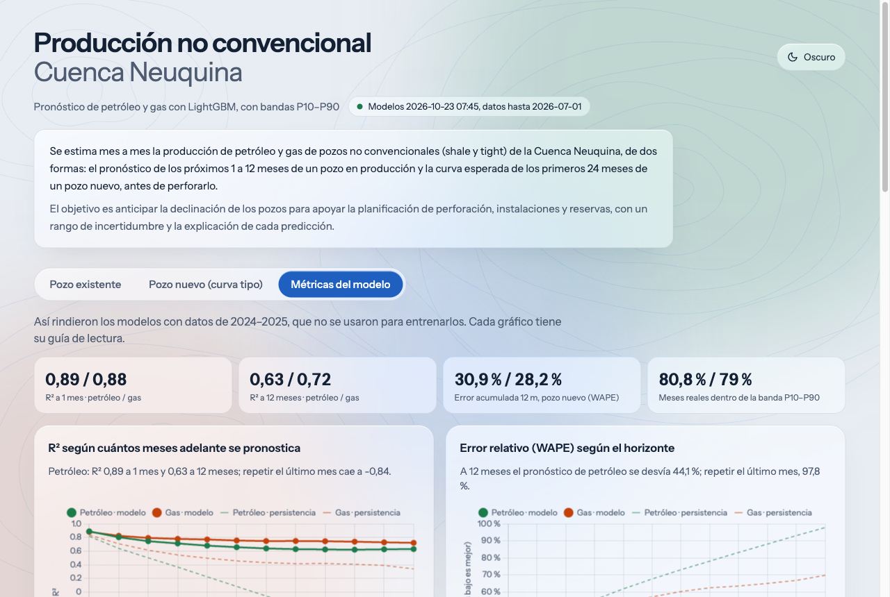

La página se adapta al celular: los formularios y las tarjetas pasan a una columna y las pestañas usan nombres cortos (Existente, Nuevo, Métricas).

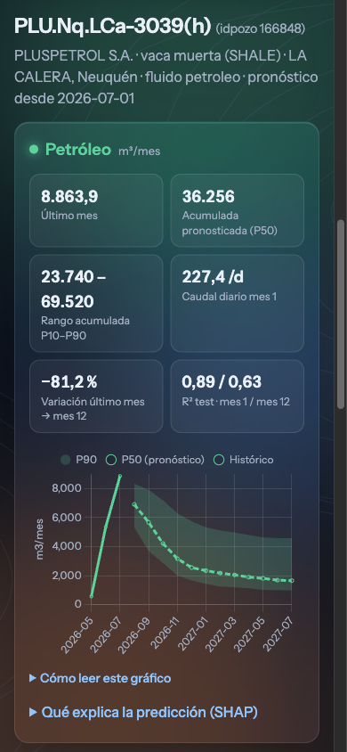

---

## 2. Unidades

| Fluido | Unidad mensual | Unidad diaria |
|---|---|---|
| Petróleo | **m³/mes** (metros cúbicos) | m³/d |
| Gas | **Mm³/mes** (miles de metros cúbicos) | Mm³/d |

Para pasar a unidades de campo: 1 m³ de petróleo ≈ 6,29 barriles; 1 Mm³ de gas = 1.000 m³ ≈ 35,3 mil pies cúbicos.

---

## 3. Modo "Pozo existente"

### 3.1 Formulario

- **Buscar pozo:** escribí parte de la sigla (`LCa-30`), el `idpozo`, o varias palabras que combinen sigla, yacimiento, operadora o formación (`ypf loma campana`, `ypf lajas`). Cada sugerencia muestra:
  - una etiqueta **activo** (verde) si el pozo produjo en el último mes del dataset, o **sin producción desde AAAA-MM** (gris) si está parado;
  - el idpozo, la formación, el yacimiento, la operadora y si es un pozo de **petróleo** o de **gas**.

  Los resultados aparecen ordenados: primero el idpozo exacto, después las siglas que empiezan con lo que escribiste, luego los pozos activos y, entre ellos, los de mayor producción reciente. **Solo los pozos activos tienen pronóstico**, porque el modelo parte del último mes producido.

- **Horizonte (meses):** cuántos meses pronosticar, de 1 a 12.
- **Pronosticar** calcula el resultado; **Limpiar** borra la búsqueda, las sugerencias y el resultado para empezar de nuevo.

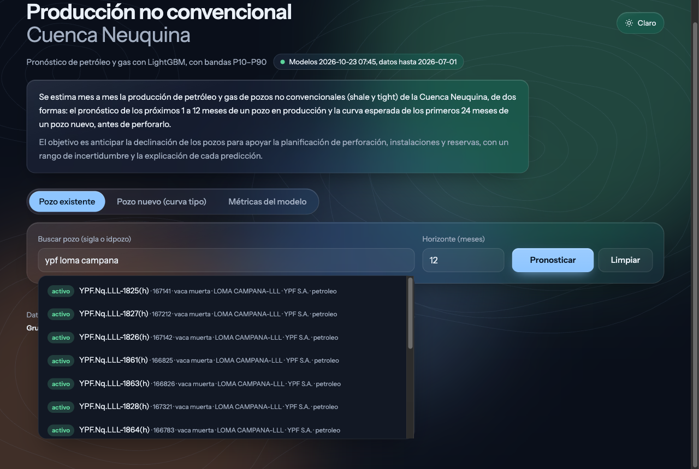

### 3.2 Encabezado del resultado

Muestra la operadora, la formación (shale o tight), el yacimiento, la provincia, el fluido dominante y **desde qué mes se pronostica** (el último mes informado del pozo).

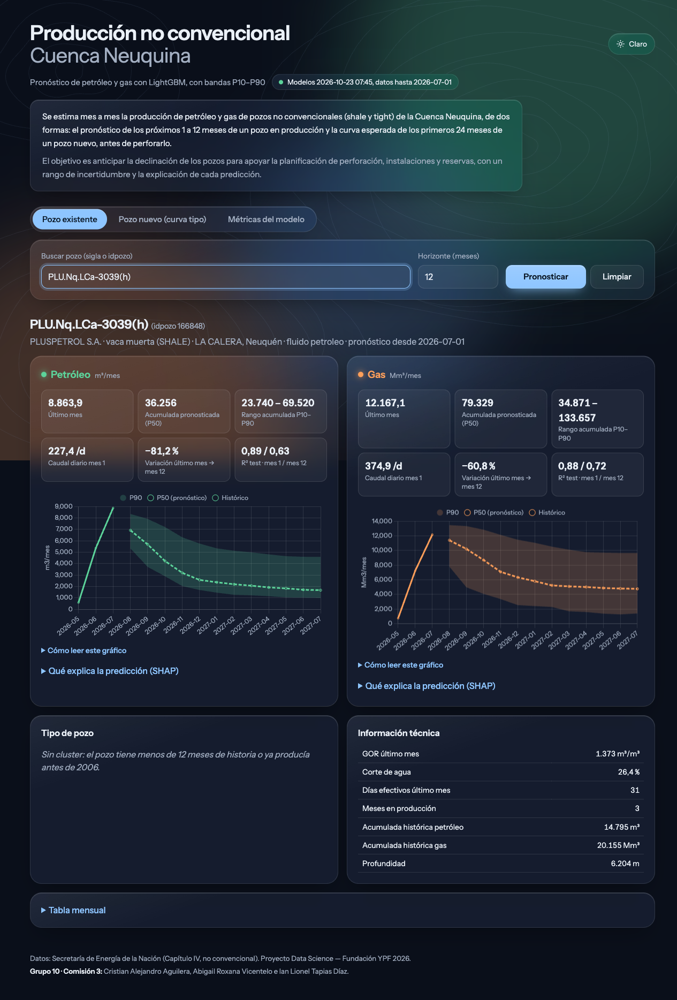

### 3.3 Tarjetas de indicadores (una para petróleo, otra para gas)

| Indicador | Qué significa | Cómo leerlo |
|---|---|---|
| **Último mes** | Producción real del último mes informado | Es el punto de partida del pronóstico |
| **Acumulada pronosticada (P50)** | Suma de la producción pronosticada en todo el horizonte | Volumen total esperado en el período |
| **Rango acumulada P10–P90** | Acumulada en el escenario bajo y en el alto | Ver la sección 5 |
| **Caudal diario mes 1** | Producción del primer mes pronosticado dividida por 30,4 días | Comparable con los caudales de campo (m³/d o Mm³/d) |
| **Variación último mes → mes 12** | Cambio porcentual entre el último mes real y el mes 12 pronosticado | **−40 %** = el pozo declina un 40 %. **+20 %** = se espera un aumento (típico de pozos que venían parados o recién arrancan) |
| **R² test · mes 1 / mes 12** | Qué tan bien predijo el modelo en 2024–2025, a 1 y a 12 meses | Cerca de 1 es excelente. Ver la sección 7 |

Si un fluido muestra *"Sin producción de este fluido en el último mes informado"*, el pozo no produjo ese fluido en su último mes (por ejemplo, el petróleo de un pozo de gas seco) y no se pronostica.

### 3.4 Gráfico

- **Línea continua:** producción **histórica real** de los últimos 24 meses.
- **Línea punteada (P50):** el **pronóstico central**.
- **Banda sombreada (P10–P90):** el **rango probable**. Ver la sección 5.

Debajo de cada gráfico, el desplegable **"Cómo leer este gráfico"** resume esta explicación dentro de la aplicación, con una muestra de cada tipo de línea:

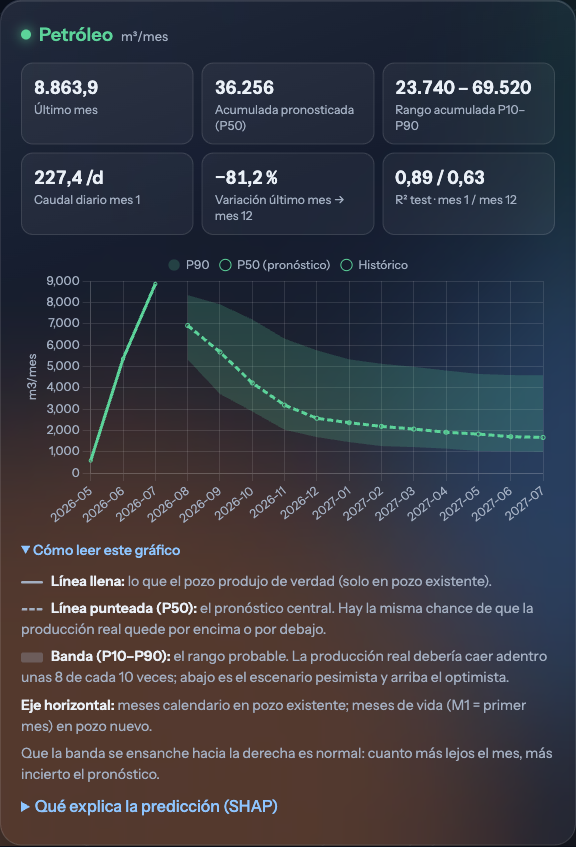

Al pasar el mouse sobre el gráfico se ven los valores de cada mes. Hay que fijarse:
1. si el pronóstico **continúa la tendencia** del histórico. Un salto brusco suele indicar que el último mes fue atípico (una parada o una reparación);
2. el **ancho de la banda**: si es angosta, el pozo es estable y el pronóstico es confiable; si es ancha, la historia es irregular y hay más incertidumbre.

### 3.5 Información técnica (tarjeta inferior derecha)

| Dato | Significado |
|---|---|
| **GOR último mes** | Relación gas/petróleo en m³ de gas por m³ de petróleo. Menos de ~3.000: pozo de petróleo. Más: pozo de gas. Un GOR que sube con el tiempo es típico cuando la presión del reservorio cae. |
| **Corte de agua** | Agua / (agua + petróleo). Un corte alto (más de 50 %) indica un pozo maduro o una entrada de agua. |
| **Días efectivos último mes** | Días que el pozo efectivamente produjo. Si es mucho menor a 30, el último mes fue parcial y el pronóstico puede verse afectado. |
| **Meses en producción** | Edad productiva del pozo. Los pozos jóvenes (menos de 12 meses) declinan rápido. |
| **Acumuladas históricas** | Todo lo que produjo el pozo desde que arrancó. |
| **Profundidad** | En los pozos horizontales es la profundidad medida, que incluye la rama lateral. |

---

## 4. Modo "Pozo nuevo (curva tipo)"

### 4.1 Formulario

| Campo | Qué poner |
|---|---|
| **Formación** | Roca objetivo. Vaca Muerta es la principal en petróleo; Lajas, Mulichinco y Punta Rosada son típicas de gas tight. |
| **Recurso** | SHALE (roca generadora) o TIGHT (arenisca de baja permeabilidad). |
| **Tipo de pozo** | Petrolífero o Gasífero: qué fluido se busca. |
| **Operadora** | Las operadoras con pocos pozos se agrupan en "OTRAS". |
| **Área de yacimiento** | Al elegirla se **prellenan latitud, longitud y profundidad típicas** de los pozos recientes del área. Se pueden modificar. |
| **Profundidad (m)** | Profundidad medida del pozo. En pozos horizontales incluye la rama: más profundidad suele significar una rama más larga y más producción. |
| **Latitud / Longitud** | Ubicación en grados decimales (negativos: sur y oeste). Tienen que estar **dentro de la Cuenca Neuquina**: latitud entre −40 y −34 y longitud entre −70,5 y −67. Fuera de ese rango el formulario y la API rechazan el pedido, porque el modelo no tiene datos de otras zonas. |
| **Año de inicio** | Año en que empezaría a producir. Funciona como proxy de la tecnología: los pozos más recientes producen más. |

> **Campos de perforación y terminación.** El proyecto incorpora el padrón *Capítulo IV* (si el pozo es horizontal, días de perforación y días de terminación). En el último entrenamiento esas variables **no mejoraron la validación**, así que el modelo no las usa y el formulario las oculta. Si un reentrenamiento futuro las selecciona, aparece automáticamente un bloque "Perforación y terminación (opcional)" prellenado con los valores típicos del área.

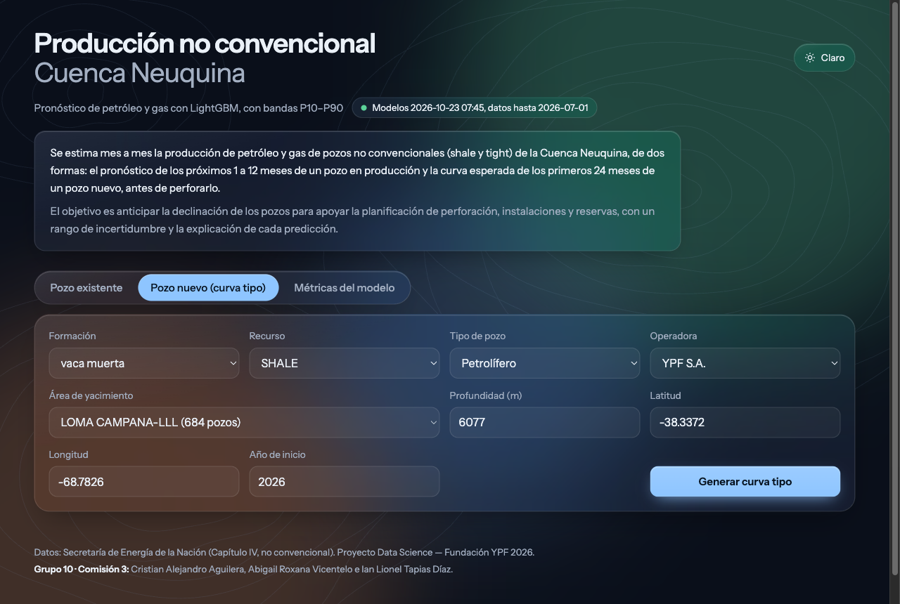

### 4.2 Resultado

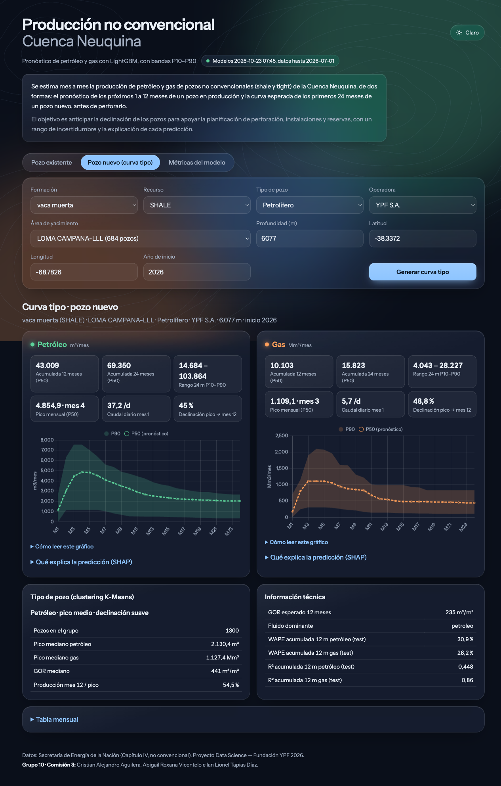

| Indicador | Significado |
|---|---|
| **Acumulada 12 meses (P50)** | Producción esperada del primer año. Es la métrica más usada para comparar pozos. |
| **Acumulada 24 meses (P50)** | Producción esperada de los dos primeros años. |
| **Rango 24 m P10–P90** | Escenario bajo y alto de la acumulada a 24 meses. |
| **Pico mensual (P50) · mes N** | Producción máxima esperada y en qué mes de vida ocurre. Lo normal es entre el mes 1 y el 4, porque el pozo va abriendo el choke de a poco. |
| **Caudal diario mes 1** | Caudal inicial promedio del primer mes. |
| **Declinación pico → mes 12** | Cuánto cae la producción entre el pico y el mes 12. En shale suele estar entre el 50 % y el 70 %: es normal que caiga fuerte el primer año. |

En la tarjeta técnica:
- **GOR esperado 12 meses** y **fluido dominante** (petróleo o gas), según las dos curvas predichas;
- **WAPE y R² de la acumulada a 12 meses**: cómo le fue al modelo con pozos de 2024–2025 que nunca vio.

El gráfico muestra solo la curva pronosticada, porque un pozo nuevo no tiene historia. El eje horizontal es el **mes de vida** (M1, M2, …).

Si la ubicación ingresada queda a más de 50 km del centro del área elegida, aparece un aviso: suele ser un error al cargar la latitud, la longitud o el área.

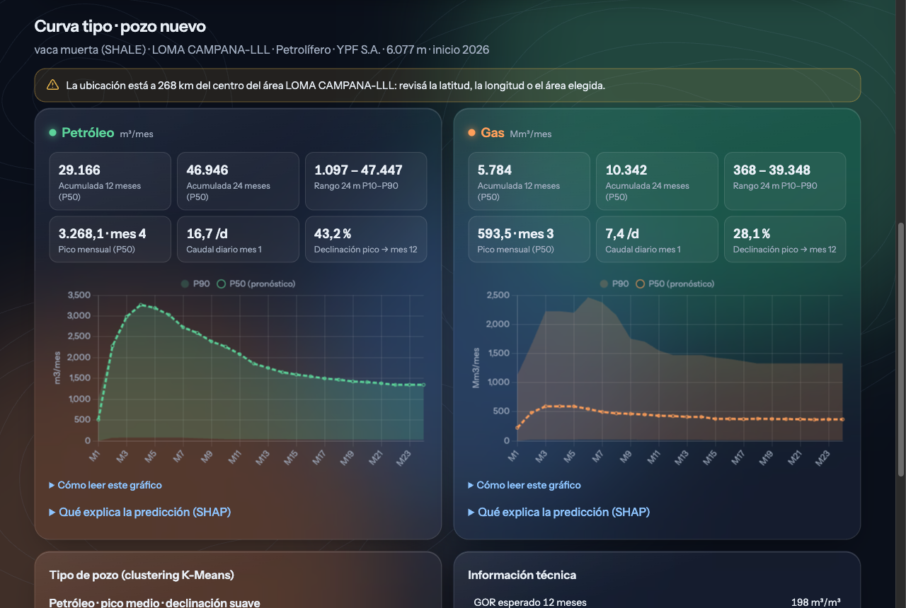

---

## 5. Cómo leer P10, P50 y P90

Son escenarios de producción:

- **P50 (línea punteada):** el valor central esperado.
- **P10 (borde inferior de la banda):** escenario **pesimista**. Solo un 10 % de las veces la producción real fue menor.
- **P90 (borde superior):** escenario **optimista**. Solo un 10 % de las veces la producción real fue mayor.

Entre P10 y P90 cae, en teoría, el **80 % de los casos**. La **cobertura** medida en test fue de ~80 % en pozos existentes y ~73 % en pozos nuevos: el rango de los pozos nuevos es un poco optimista sobre su propia precisión.

> **Atención:** este proyecto usa la convención estadística (P10 = valor bajo). En la industria a veces se usa la contraria (P90 = estimación conservadora). Acá **P10 siempre es el escenario bajo**.

Las **acumuladas P10 y P90** suman los P10 y P90 de cada mes. Es un escenario extremo (todos los meses malos o todos buenos a la vez), por eso el rango de la acumulada es más amplio que el real.

---

## 6. "Qué explica la predicción" (SHAP)

Al desplegar esta sección aparece una tabla con las **6 variables que más influyeron** en la predicción y su **impacto**:

- **Impacto positivo (+):** esa variable **empujó la predicción hacia arriba** respecto del promedio del modelo.
- **Impacto negativo (−):** la **empujó hacia abajo**.
- Cuanto mayor el valor absoluto, más pesó la variable.

La unidad aparece en el encabezado de la columna y depende del modelo:
- **Ratio vs último mes** (pozo existente): el modelo predice cuánto va a producir el pozo en relación con su último mes (1 = igual, 0,8 = 20 % menos). Por ejemplo, −0,15 en "Meses en producción" significa que la edad del pozo restó ~0,15 al ratio: el pozo es maduro y declina.
- **m³/mes o Mm³/mes** (pozo nuevo con modelo aditivo, hoy petróleo): cuántas unidades por mes suma o resta esa variable, promediado sobre los 24 meses. Por ejemplo, +395 en "Área de yacimiento" significa que esa zona suma ~395 m³/mes respecto de un pozo promedio.
- **%** (pozo nuevo con modelo multiplicativo Tweedie/Poisson, hoy gas): en cuánto por ciento sube o baja la producción por esa variable. Por ejemplo, +33 % en "Profundidad" significa que la profundidad hace que se espere un 33 % más de gas que en un pozo promedio.

Variables frecuentes:

| Variable | Interpretación típica |
|---|---|
| Producción actual / pico | Cerca de 1 = el pozo está en su pico y va a declinar. Baja = ya declinó y se estabiliza. |
| Tendencia 3 meses | Positiva = venía subiendo. Negativa = venía cayendo. |
| Meses en producción | Pozos jóvenes declinan más rápido. |
| Horizonte del pronóstico | Más lejos en el tiempo = menor producción esperada. |
| Fracción de días en producción | Si el último mes fue parcial (pocos días), el modelo espera una recuperación. |
| Área / Profundidad / Año de inicio | En pozos nuevos: zona productiva, rama más larga, tecnología más reciente. |

---

## 7. Métricas del modelo

| Métrica | Qué mide | Cómo leerla |
|---|---|---|
| **R²** | Proporción de la variabilidad real que explica el modelo | 1 = perfecto; 0 = igual que predecir siempre el promedio; negativo = peor que el promedio |
| **WAPE** | Error absoluto total / producción total | 0,30 = el error es, en promedio, el 30 % de la producción. Menor es mejor |
| **Cobertura P10–P90** | Fracción de casos reales dentro de la banda | Ideal ≈ 0,80 |

Todas se midieron con datos de **2024–2025, que el modelo nunca vio al entrenar**.

**Por qué hay dos R² en pozo existente (mes 1 / mes 12):** predecir el mes siguiente es fácil, porque se parece mucho al último mes (R² ≈ 0,89). Predecir dentro de 12 meses es difícil (R² ≈ 0,63). El valor del modelo está justamente en el largo plazo: ahí "repetir el último mes" falla mucho más.

### 7.1 Pestaña "Métricas del modelo" (dashboard)

La tercera pestaña reúne estas métricas en gráficos, sin necesidad de hacer un pronóstico. Arriba hay cuatro indicadores: R² a 1 y a 12 meses, error de la acumulada a 12 meses de un pozo nuevo y cobertura de la banda P10–P90 (petróleo / gas). Cada gráfico trae una frase con su lectura clave y un desplegable **"Cómo leer este gráfico"**.

| Gráfico | Qué muestra | Cómo leerlo |
|---|---|---|
| R² según el horizonte | R² de 1 a 12 meses adelante, del modelo (líneas gruesas) y de repetir el último mes (líneas finas punteadas) | Más arriba es mejor. A 1 mes ambos aciertan; la diferencia aparece a 6–12 meses |
| WAPE según el horizonte | El error relativo para cada horizonte | Más abajo es mejor. El error del modelo crece más despacio que el de la persistencia |
| Pozo existente contra métodos clásicos | Backtest desde diciembre de 2023: modelo, curva de Arps y persistencia | R² más alto y WAPE más bajo indican mejor método |
| Pozo nuevo contra curva mediana | Acumulada de los primeros 12 meses: modelo contra "el pozo típico de la formación" | Un R² negativo es peor que predecir siempre el promedio |
| ¿La banda P10–P90 es confiable? | Porcentaje de meses reales dentro de la banda, para los 4 modelos | Lo ideal es estar cerca de la línea del 80 % |
| Elección de k | Silhouette y Davies-Bouldin según la cantidad de grupos del clustering | Se eligió k = 4, donde la silhouette es máxima |
| Los 4 tipos de pozo | Cantidad de pozos por grupo (barras) y retención al mes 12 (puntos) | Retención baja = el pozo arranca alto y cae rápido |
| Comparación con la versión anterior | R² a 1 mes de la versión 1 contra la versión 2 con el mismo alcance | 0,907 contra 0,906: mismo nivel, pero ahora con gas y hasta 12 meses |

Al pie figuran los cortes temporales (entrenamiento, validación y test) y la cantidad de filas usadas.

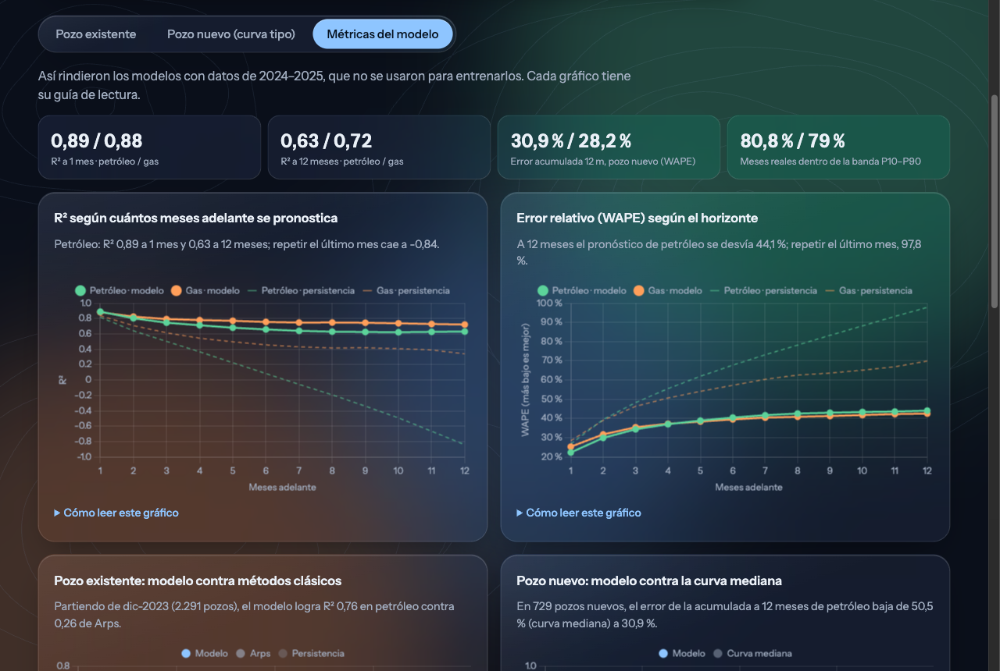

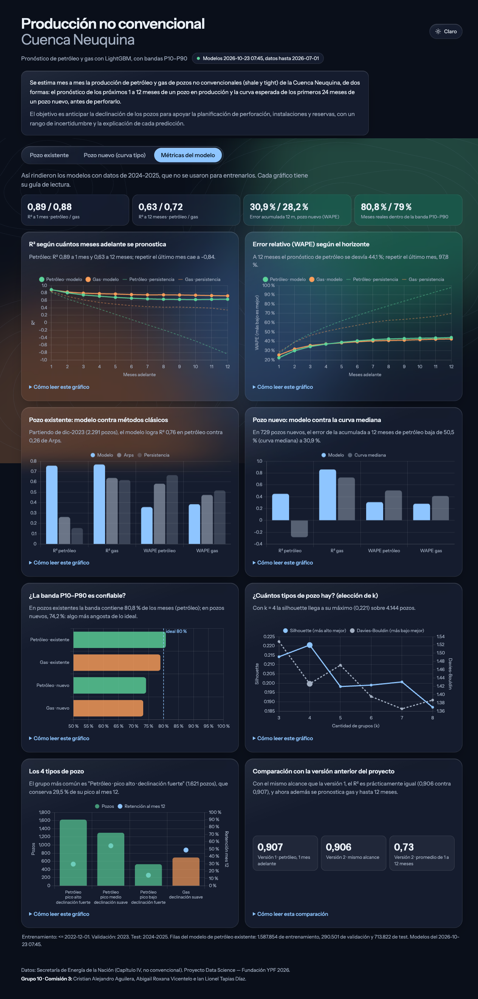

Si se pasa a esta pestaña después de un pronóstico, el resultado no se pierde: al volver a "Pozo existente" o "Pozo nuevo" sigue ahí.

---

## 8. Tipo de pozo (cluster)

La tarjeta **"Tipo de pozo (clustering K-Means)"** ubica al pozo en uno de los grupos encontrados al agrupar todos los pozos por la **forma de su curva** de los primeros 12 meses, el tamaño de su pico y su GOR. Ejemplo: *"Petróleo · pico alto · declinación fuerte"*.

- **Pozos en el grupo:** cuántos pozos históricos comparten ese comportamiento.
- **Pico mediano / GOR mediano:** valores típicos del grupo, para comparar.
- **Producción mes 12 / pico:** qué fracción del pico conserva un pozo típico del grupo al mes 12. Por ejemplo, 35 % = cayó un 65 %.

En pozos nuevos el grupo se calcula a partir de la curva predicha. Si dice *"Sin cluster"*, el pozo tiene menos de 12 meses de historia o ya producía antes de 2006, cuando arranca el registro.

---

## 9. Avisos (recuadros amarillos) y errores (recuadros rojos)

| Aviso | Qué hacer |
|---|---|
| *El último dato del pozo es AAAA-MM (N meses antes del fin del dataset)* | El pozo dejó de informar: el pronóstico parte de una fecha vieja y puede no reflejar su estado actual. |
| *El pozo ya producía antes de 2006* | Su edad real es mayor que la registrada; "Meses en producción" está subestimado. |
| *El pozo no produjo en su último mes informado (última producción: AAAA-MM)* | El pozo está parado: no hay pronóstico. Elegí un pozo marcado como **activo**. |
| *Sin producción de X en el último mes* | El pozo produce solo uno de los dos fluidos: el otro no se pronostica. |
| *X está fuera del rango de entrenamiento* | El dato ingresado es más extremo que todos los pozos conocidos: el modelo extrapola y el resultado es poco confiable. |
| *Pozos futuros: el modelo asume la tecnología del último año conocido* | Para años posteriores a los datos, el modelo no puede anticipar mejoras tecnológicas. |
| *Se usaron valores típicos del área para …* | Faltaban datos opcionales y se completaron con la mediana del área. |
| *La ubicación está a N km del centro del área …* | Revisar la latitud, la longitud o el área: probablemente no coinciden. |

Los **errores** (recuadro rojo) frenan el pronóstico y dicen qué corregir. Por ejemplo: *"La latitud -45.0 está fuera de la Cuenca Neuquina (debe estar entre -40.0 y -34.0)"*.

---

## 10. Tabla mensual

Al final, **"Tabla mensual"** despliega los valores P10 / P50 / P90 de petróleo y gas de cada mes. Sirve para copiarlos a una planilla.

---

## 11. Ejemplos guiados

**Pozo existente.** Buscar `LCa-3008`, horizonte 12, Pronosticar.
1. Mirar el encabezado: es un pozo de **gas** de Vaca Muerta y el pronóstico parte del último mes informado.
2. En el gráfico, comparar el histórico con el P50: si el pozo venía parado y retomó, el modelo espera una recuperación o una estabilización.
3. Leer la acumulada P50 y su rango P10–P90: es el volumen esperado del próximo año.
4. Abrir SHAP para ver por qué: por ejemplo, "Fracción de días en producción" alta y "Meses en producción".

**Pozo nuevo.** Formación *vaca muerta*, SHALE, Petrolífero, YPF, área *LOMA CAMPANA-LLL* (se completan la ubicación y la profundidad), año 2026, Generar curva tipo.
1. **Acumulada 12 meses:** la producción esperada del primer año.
2. **Pico y mes del pico:** el caudal máximo y cuándo ocurre.
3. **Declinación pico → mes 12:** cuánto cae en el primer año. En shale es normal que sea alta.
4. **Cambiar una sola variable** (por ejemplo, la profundidad o el área) y comparar: así se ve la sensibilidad del pronóstico.

---

## 12. Límites de interpretación

- Es una **herramienta orientativa**: no reemplaza un estudio de reservorio ni debe ser la única base de una decisión de inversión.
- El dataset público **no incluye** el largo de la rama lateral, la cantidad de etapas de fractura ni el volumen de arena, que son los principales determinantes de la producción de un pozo nuevo. Por eso el modo "pozo nuevo" tiene más error que el modo "pozo existente".
- Eventos no predecibles (paradas, restricciones de transporte, decisiones comerciales) no están en los datos.
- La mayoría de los datos son de **Vaca Muerta e YPF**: en formaciones u operadoras con pocos pozos, la predicción es menos confiable.
